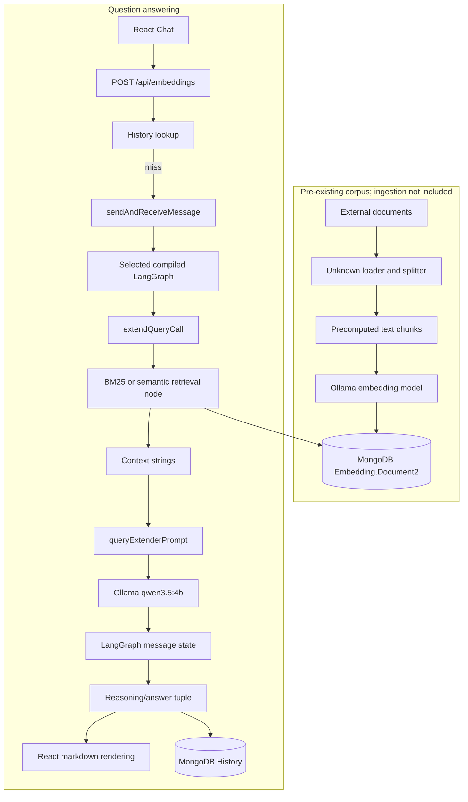

# RAG System Analysis

## Executive summary

This repository implements a TypeScript/Express RAG application with a React/Vite client. The backend reads a pre-existing MongoDB corpus, expands the user query with a local Ollama model, executes one of three LangGraph pipelines, retrieves context using either in-memory BM25 or MongoDB Atlas vector search, and asks the same Ollama chat model to synthesize an answer. Query results are cached in MongoDB history.

There is **no document ingestion/indexing implementation in the inspected application code**: no loader, PDF parser, text splitter, embedding write path, or vector-store population job is present. The `Embedding.Document2` collection must already contain text, embeddings, source identifiers, and line ranges.

## Technology stack

| Component         | Implementation                                                                                 |
| ----------------- | ---------------------------------------------------------------------------------------------- |
| Language          | TypeScript 5.9, React/TSX                                                                      |
| Runtime           | Node.js, ESM; `tsx` for development                                                            |
| LLM               | Ollama `qwen3.5:4b`, temperature `0`                                                           |
| Embeddings        | Ollama `qwen3-embedding:latest`, dimensions `1024`                                             |
| Vector store      | `MongoDBAtlasVectorSearch`, MongoDB collection `Embedding.Document2`, index `vector_index`     |
| Lexical retrieval | `wink-bm25-text-search` with `wink-nlp`                                                        |
| Document loader   | None in this repository; corpus is read from MongoDB                                           |
| Text splitter     | None in this repository; chunking is upstream/unknown                                          |
| LangChain         | `@langchain/core`, `@langchain/ollama`, `@langchain/mongodb`, `@langchain/textsplitters`, etc. |
| LangGraph         | `@langchain/langgraph` `^1.4.13`                                                               |
| API               | Express 5, CORS, JSON routes                                                                   |
| Persistence       | MongoDB; query history in `Embedding.History`; no LangGraph checkpointer                       |
| Client            | React/Vite, served by Vite in development and nginx in the container                           |

Configuration is loaded from `.env.local` or `.env.docker` in `backend/src/server.ts`. `OLLAMA_BASE_URL` defaults to `http://localhost:11434`; MongoDB uses `MONGO_URI`.

## Architecture overview



## Ingestion and indexing

The expected stored document shape is `MyDocument` in `backend/src/types/types.ts`: `text`, `embedding: number[]`, `source`, and `loc.lines.from/to`. The backend reads this shape through `collection`, configured as database `Embedding`, collection `Document2` in `backend/src/mongo/mongoClientFactory.ts`.

No code in the repository performs the following steps:

```text
Source document -> loader -> text splitter -> chunks -> embedding generation -> MongoDB write
```

Consequently, the following values cannot be confirmed: source file formats, loader class, chunk size, overlap, separators, embedding-generation timing, document IDs assigned during indexing, and whether indexing is manual or scheduled. The embedding model configured for query/vector operations is `OllamaEmbeddings` with `qwen3-embedding:latest` and `dimensions: 1024` (`backend/src/models/models.ts`).

## Query flow

```text
React Chat.sendToLLM()
  -> getEmbedding(query, searchType)
  -> POST /api/embeddings
  -> findQueryResult(query, searchType)
  -> cached tuple, or sendAndReceiveMessage()
  -> selected graph.invoke({ messages: [HumanMessage(query)] })
  -> extendQueryCall
  -> search/synthesis node
  -> ChatOllama response
  -> persistQueryResult()
  -> [reasoning, answer] JSON tuple
  -> LLMOutput markdown rendering
```

The client sends `query` and `searchType` from `client/src/chat/Chat.tsx` and `client/src/api/api.ts`. The server returns HTTP 200 for a cache hit and HTTP 201 for a new result. History is fetched separately from `/api/history`.

## LangGraph architecture

There are three compiled graphs, each with the same two-node topology:

```text
START -> extendQueryCall -> syntheziserCall -> END
```

- `backend/src/stateGraphs/bm25Graph.ts`: query expansion then `syntheziserBm25Call`.
- `backend/src/stateGraphs/bm25ExtendedGraph.ts`: query expansion then `syntheziserBm25ExtendedCall`.
- `backend/src/stateGraphs/semanticExtendedGraph.ts`: query expansion then `syntheziserSemanticExtendedCall`.

`backend/src/invoke/invoke.ts` maps `BM25`, `BM25Extended`, and `SemanticExtended` to these graphs. There are no conditional edges, loops, tool nodes, agent loops, or checkpointers. Compilation is performed by `.compile()` on each `StateGraph`.

## LangGraph state

`backend/src/schema/messagesSchema.ts` defines the state:

| State field     | Type                        | Created by                                                              | Read by                       | Modified by                         | Purpose                                                       |
| --------------- | --------------------------- | ----------------------------------------------------------------------- | ----------------------------- | ----------------------------------- | ------------------------------------------------------------- |
| `messages`      | LangGraph `MessagesValue`   | invocation with one `HumanMessage`; synthesis node returns one response | query expansion and synthesis | LangGraph message reducer           | User input and model messages                                 |
| `searchQueries` | optional `string[]`         | `extendQueryCall`                                                       | all retrieval/synthesis nodes | replaced by expansion result        | Expanded retrieval queries                                    |
| `searchResults` | optional `string[]`         | none observed                                                           | none observed                 | none observed                       | Declared but unused                                           |
| `llmCalls`      | reduced number, default `0` | schema default                                                          | not observed                  | synthesis returns `1`, reducer adds | Counts synthesis calls; query expansion does not increment it |

State is in-memory for one invocation. MongoDB history persistence is application-level result caching, not LangGraph checkpointing. Conversation history is not accumulated: each request starts with one `HumanMessage`, and the response is stored only as a history record containing serialized answer/reasoning.

## Query expansion and retrieval

`extendQueryCall` uses `defaultStructuredModel`, a structured-output `ChatOllama`, with a system instruction to rephrase the question, add synonyms/related terms, and return an array. Its schema requires `userQuery` and `queries`; only `response.queries` is written into state. All three modes therefore call an LLM before retrieval, including the nominal BM25 mode.

### BM25

`syntheziserBm25Call` loads every `Document2` record with `getAllDocuments()`. For each expanded query, `bm25Search()` builds a fresh `wink-bm25-text-search` index over `doc.text`, tokenized by `wink-nlp`. Configuration is `k1: 1.5`, `b: 0.75`, `k: 1`, with text field weight `1`. Results from all expanded queries are combined by Mongo `_id`, their BM25 scores are summed, sorted descending, and limited to five chunks. The five `pageContent` values become the prompt context.

### BM25Extended

This follows the same BM25 process and top-five selection. It then groups results by `source`, expands each line range by `DEFAULT_CHUNK_EXTENSION = 30`, merges overlapping ranges, and queries MongoDB for chunks within each source/range. The matching `text` values are joined with newlines and supplied as context.

### SemanticExtended

`prepareDocumentBySimilaritySearch()` calls `vectorStore.similaritySearchWithScore(query, 4)` for each expanded query. The vector store is configured with `indexName: "vector_index"`, `textKey: "text"`, and `embeddingKey: "embedding"`. Each query contributes its highest-scoring result, duplicate `fromLine` values are removed, and the remaining results undergo the same source grouping, 30-line expansion, Mongo range lookup, and newline joining as BM25Extended.

No metadata filters, score thresholds, reranker, or explicit `k` beyond the semantic value `4` are present. Semantic query embedding is generated internally by `OllamaEmbeddings`; BM25 does not use embeddings.

## Retrieved documents and context

Mongo vector results are LangChain `Document` objects whose `pageContent` is mapped from `text`; metadata is expected to contain `source` and `loc.lines.from/to`. The BM25 path uses plain Mongo records and maps `text`, `_id`, `source`, and projected line fields. Extended retrieval discards metadata when it creates each context string: only matching `text` values joined by `\n` reach the prompt.

The non-extended BM25 prompt receives only the top-five chunk text values. The extended modes receive expanded line-window text. Source names and line numbers are used for retrieval/merging but are not explicitly formatted into the final context, so source attribution in the generated answer is not guaranteed by the data passed to the model.

## Prompts and LLM calls

### Query expansion prompt

Location: `backend/src/calls/semanticExtended/extendQueryCall.ts`.

Inputs are the initial `state.messages`, normally one user `HumanMessage`. The system message asks for a detailed, neutral rephrasing with synonyms and related terms and requests only expanded queries. The structured result is validated against `QueriesStructuredOutput`; `queries` becomes state.

### Answer synthesis prompt

Location: `backend/src/prompt/queryExtenderPrompt.ts`. Despite its name, this is the active answer-synthesis prompt. It receives `extendedChunks: string[]`, serializes them with `JSON.stringify`, and instructs the model to answer from context, identify evidence, confidence, and gaps, avoid fabricating retrieved facts, and remain useful when context is absent. It requests this format: `Answer`, `Evidence`, `Confidence`, and `Gaps`.

Each synthesis node creates a `SystemMessage(systemMessage)` and appends the original `state.messages`; it then invokes `defaultChatModel`. `defaultChatModel` is `ChatOllama` using `qwen3.5:4b`, temperature `0`, and the configured Ollama base URL. There is no explicit output parser, streaming, retry, fallback model, token limit, callback, or tool call in the application code. The response is returned as a message and its `contentBlocks` are later indexed by `sendAndReceiveMessage()`.

## Final response and persistence

`sendAndReceiveMessage()` reads `result.messages[1].contentBlocks[0].reasoning` and `[1].text`, serializes both with `JSON.stringify`, persists them with the original query and search type into `Embedding.History`, and returns `[reasoning, answer]`. The client assumes both tuple entries are strings, converts escaped newlines, and renders them through `marked.parse()` in `client/src/chat/LLMOutput.tsx`.

The cache lookup uses exact `userQuery` and `searchType`. `findHistory()` returns the latest 15 history records. This is result caching/history, not conversational context supplied to the LLM.

## LangChain component map

| Component                     | Location                                  | Purpose                               | Input                    | Output                         |
| ----------------------------- | ----------------------------------------- | ------------------------------------- | ------------------------ | ------------------------------ |
| `HumanMessage`                | `backend/src/invoke/invoke.ts`            | Wraps user input                      | query string             | message                        |
| `SystemMessage`               | query expansion and synthesis nodes       | Supplies instructions                 | prompt text              | message                        |
| `ChatOllama`                  | `backend/src/models/models.ts`            | Query expansion and answer generation | messages                 | AI message / structured object |
| `OllamaEmbeddings`            | `backend/src/models/models.ts`            | Embeds semantic search queries        | query text               | vector                         |
| `MongoDBAtlasVectorSearch`    | `backend/src/mongo/mongoClientFactory.ts` | Semantic retrieval                    | query + stored vectors   | scored LangChain documents     |
| `wink-bm25-text-search`       | `backend/src/retrival/utils.ts`           | Lexical retrieval                     | tokenized corpus + query | scored record IDs              |
| `StateGraph`                  | `backend/src/stateGraphs/*.ts`            | Orchestrates nodes                    | graph state              | compiled graph result          |
| `StateSchema`/`MessagesValue` | `backend/src/schema/messagesSchema.ts`    | Defines state and message handling    | state updates            | merged state                   |

No `RunnableSequence`, `Retriever` wrapper, output parser, agent, or tool abstraction is used explicitly.

## Conversation, tools, and agents

The inspected implementation does not contain persistent conversational memory. Each API request has an independent message list containing only the current question. History records can be displayed and restored in the UI, but restored text is not sent back into a subsequent graph invocation.

This is not a tool-using agent architecture. There are no tool schemas, tool calls, tool execution nodes, conditional tool loops, or agent executors. The name `semanticExtendedAgent` refers to a compiled two-node graph, not an LLM tool agent.

## Error and failure flows

```text
Mongo startup failure
  -> connectDB() rejection
  -> server logs "Database connection failed"
  -> process.exit(1)

Unknown search type
  -> graphMap.get() returns undefined
  -> sendAndReceiveMessage() throws
  -> /api/embeddings catches it
  -> HTTP 500 { message: "Failed to send query" }

Mongo/query expansion/retrieval/LLM/persistence failure
  -> promise rejection propagates through graph/invocation
  -> route catch logs error
  -> HTTP 500 generic message

Client non-2xx response
  -> getEmbedding()/getHistory() throws Request failed
  -> Chat does not catch it locally

Unexpected model content shape
  -> contentBlocks indexing or client .replace() can throw
```

`getDB()` also throws `Database not initialized`, although the inspected query paths use their own Mongo clients/collections. There is no application-level retry or fallback behavior. Mongo helper functions generally close their client in `finally`; `prepareDocumentBySimilaritySearch()` connects/closes the shared client around the loop, while `extendGivenContext()` creates its own connect/close cycle.

## Important code paths

### 1. New user question

Trigger: clicking Send in `client/src/chat/Chat.tsx`.

```text
Chat.sendToLLM
 -> getEmbedding
 -> POST /api/embeddings
 -> findQueryResult
 -> sendAndReceiveMessage
 -> selected graph
 -> persistQueryResult
 -> [reasoning, answer]
```

### 2. Query expansion

```text
HumanMessage(query)
 -> extendQueryCall
 -> structured qwen3.5:4b
 -> response.queries
 -> state.searchQueries
```

### 3. SemanticExtended retrieval

```text
state.searchQueries
 -> similaritySearchWithScore(query, 4)
 -> highest-scoring result per expanded query
 -> duplicate line removal
 -> source/range grouping with 30-line padding
 -> Mongo line-window lookup
 -> newline-joined context
```

### 4. BM25 retrieval

```text
state.searchQueries
 -> getAllDocuments
 -> fresh BM25 index per query
 -> score aggregation by _id
 -> top five text chunks
 -> prompt context
```

### 5. Answer generation

```text
context strings + original HumanMessage
 -> queryExtenderPrompt
 -> SystemMessage + user message
 -> defaultChatModel
 -> AI message contentBlocks
 -> serialized reasoning/answer
 -> client markdown
```

## Quality characteristics and architectural risks

### Observed implementation

- Semantic retrieval uses four candidates per expanded query, then keeps only one result per query before expansion.
- BM25 and semantic modes both depend on query expansion by the same local LLM.
- BM25 rebuilds an index for each expanded query and loads the complete collection, which may be expensive as the corpus grows.
- Extended retrieval adds 30 lines on each side and merges overlapping ranges.
- The answer prompt explicitly requests evidence, confidence, gaps, and non-fabrication, but the context passed to it contains text only and generally omits source identifiers.
- There is no reranking, relevance grading, query retry, answer validation, or fallback model.
- Exact query/search-type history caching can return an old answer even if the underlying corpus changes.

### Potential concerns

1. **Missing ingestion boundary:** the repository cannot reproduce or validate how stored chunks and embeddings were created.
2. **Source attribution gap:** source/line metadata is used before context construction but is not included in the context strings.
3. **Model-output coupling:** `sendAndReceiveMessage()` assumes `contentBlocks[0]` is reasoning and `[1]` is answer text; a provider/content-block shape change can fail or produce incorrect output.
4. **No request validation:** routes accept arbitrary request bodies and do not validate that `query` and `searchType` are present or of the expected type.
5. **Resource/concurrency risk:** shared Mongo client connection management and repeated connect/close operations can be fragile under concurrent requests.
6. **Client error handling:** `Chat` has no local error state, and `LLMOutput` calls `.replace()` on tuple values without runtime type checks.
7. **Prompt naming/duplication:** `queryExtenderPrompt` is used for synthesis despite its name; the repository also contains a likely duplicate/unused prompt file (`outputSynteziserPrompt.ts`).

These are implementation observations and risks, not claims that the application always fails under those conditions.

## Most important files

1. `backend/src/invoke/invoke.ts` — API-to-graph selection and result persistence.
2. `backend/src/schema/messagesSchema.ts` — LangGraph state and structured query schema.
3. `backend/src/stateGraphs/bm25Graph.ts` — BM25 graph topology.
4. `backend/src/stateGraphs/bm25ExtendedGraph.ts` — extended BM25 topology.
5. `backend/src/stateGraphs/semanticExtendedGraph.ts` — semantic extended topology.
6. `backend/src/retrival/utils.ts` — BM25, vector retrieval, deduplication, and context expansion.
7. `backend/src/mongo/mongoClientFactory.ts` — Mongo collections, vector store, range retrieval, and history persistence.
8. `backend/src/models/models.ts` — Ollama chat and embedding models.
9. `backend/src/prompt/queryExtenderPrompt.ts` — synthesis prompt.
10. `backend/src/routes/routes.ts` — HTTP error boundary and cache behavior.

## Important findings

### How the RAG system works

A user question is first checked against MongoDB history. LangGraph expands the question into several retrieval queries. The selected graph then performs BM25 or MongoDB vector retrieval, optionally expands matching source line ranges by 30 lines, embeds the resulting context into a synthesis prompt, and calls Ollama `qwen3.5:4b`. The answer and reasoning are cached and returned to the React client.

### Main data flows

```text
Pre-existing chunk + pre-existing embedding -> MongoDB Document2
Question -> query expansion -> BM25/vector retrieval -> context -> prompt -> Ollama -> answer
```

### Main LangGraph flow

```text
START -> extendQueryCall -> syntheziserCall -> END
```

### Unknowns

The repository does not provide enough evidence to determine:

- original document sources and file formats;
- document loader and text splitter;
- chunk size, overlap, separators, and indexing schedule;
- the process that generated and inserted `embedding` values;
- MongoDB Atlas index definition and deployment settings;
- whether the stored corpus is complete or refreshed incrementally;
- the exact runtime shape of Ollama `contentBlocks` for every response;
- whether `outputSynteziserPrompt.ts` is used outside the inspected paths.
